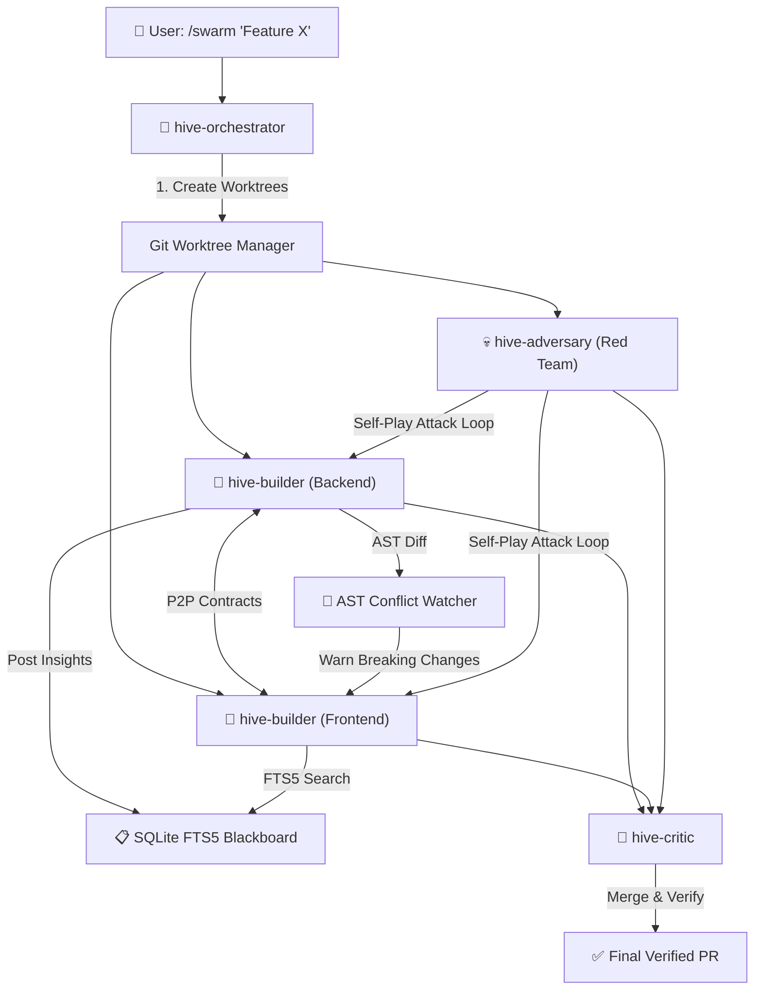

# 🐝 HiveMesh — Multi-Agent Swarm Engine for Antigravity

[](https://opensource.org/licenses/MIT)
[](https://github.com/ghazy2001/hivemesh)
[](https://nodejs.org/)

**HiveMesh** is an all-in-one multi-agent orchestration engine and plugin for **Google Antigravity** and **Claude Code**. It transforms a single prompt into an autonomous swarm of specialized agents working in parallel Git worktrees with:

1. 📋 **SQLite FTS5 Blackboard**: Native full-text search with BM25 ranking for instant zero-token architectural discovery reuse.
2. 🔬 **Deep TypeScript AST Conflict Engine**: Real-time detection of function and interface signature changes across branches to prevent semantic build breaks.
3. 🤝 **P2P Contract Negotiation**: Inter-agent interface handshakes before coding begins.
4. 💀 **Adversarial Self-Play**: Automated Red-Team vs Blue-Team fuzzing and probing loop for edge cases, race conditions, and vulnerabilities.
5. 📊 **Generative UI Canvas**: Live visual mission control topology rendered directly in the conversation.
6. 💻 **Standalone CLI**: Launch swarms directly from the terminal with `npx hivemesh run`.

---

## 🏗️ Architecture



---

## 🛠️ MCP Tools (12 Tools)

| Tool | Description |
|:-----|:------------|
| `hivemesh_create_swarm` | Creates isolated Git worktrees and branches for parallel agents. |
| `hivemesh_swarm_status` | Returns the real-time status of all agents and active worktrees. |
| `hivemesh_destroy_swarm` | Cleans up worktrees and branches when work is done. |
| `hivemesh_blackboard_post` | Publishes architectural discoveries into SQLite with FTS5 indexing. |
| `hivemesh_blackboard_query` | Natural-language full-text search across knowledge using SQLite FTS5 & BM25 ranking. |
| `hivemesh_blackboard_list_topics` | Lists all knowledge categories with counts and agent statistics. |
| `hivemesh_propose_contract` | Proposes an API/schema contract between two agents before coding. |
| `hivemesh_respond_contract` | Accepts or rejects a proposed interface contract. |
| `hivemesh_check_ast_changes` | Deep TypeScript AST analysis detecting breaking changes and cross-worktree reference conflicts. |
| `hivemesh_self_play_round` | Runs automated Red-Team adversarial attack tests against builder branches with remediation guidance. |
| `hivemesh_canvas_view` | Generates an interactive SVG/HTML Generative UI canvas for the swarm topology. |
| `hivemesh_dashboard` | Generates a live markdown mission control dashboard. |

---

## 💻 Standalone CLI Usage

HiveMesh can be run as a standalone CLI in any terminal or CI/CD environment:

```bash
# Verify your environment
npx hivemesh doctor

# Launch a parallel swarm
npx hivemesh run "Add passkeys to authentication" --roles backend,frontend,security

# Check active swarms
npx hivemesh status

# Clean up worktrees
npx hivemesh clean <swarmId>
```

---

## 👥 Specialized Agent Roles

- **`hive-orchestrator`**: Master coordinator, decomposes prompts, creates swarms, coordinates merges.
- **`hive-builder`**: Feature implementation specialist operating strictly in an isolated worktree.
- **`hive-adversary`**: Red-team security tester that fuzzes inputs, tests race conditions, and runs adversarial self-play rounds.
- **`hive-critic`**: Integration reviewer that verifies AST changes, contracts, builds, and test runs before merge.

---

## 🚀 Antigravity Plugin Setup

1. Copy or link to `~/.gemini/config/plugins/hivemesh/`.
2. Build the TypeScript engine:
   ```bash
   cd engine && npm install && npm run build
   ```
3. Restart Antigravity to reload plugin configurations.
4. Launch a swarm from chat:
   ```text
   Use the hivemesh skill to create a swarm of 3 agents for adding webhooks with backend, frontend, and adversarial testing.
   ```

---

## 🧪 Testing

Run the automated integration test suite:

```bash
npm test
```

---

## 📄 License
MIT © [Mahmoud Ghazy](https://github.com/ghazy2001)
