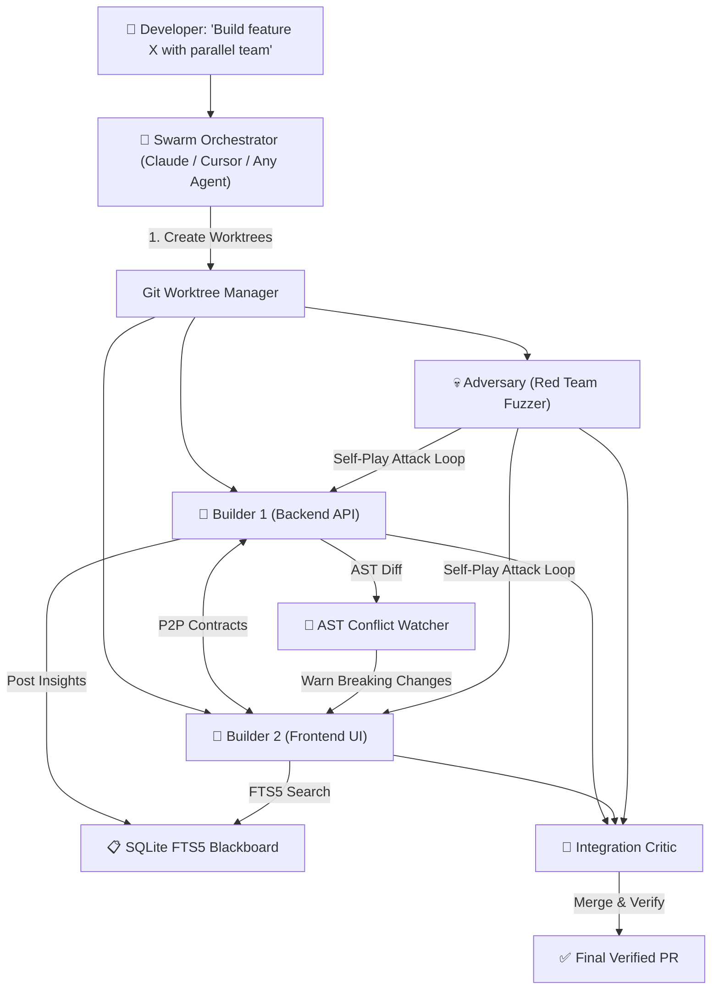

# 🐝 HiveMesh — The Universal Multi-Agent Swarm Engine

[](https://opensource.org/licenses/MIT)
[](https://github.com/ghazy2001/hivemesh)
[](https://modelcontextprotocol.io/)
[](https://github.com/ghazy2001/hivemesh)

**HiveMesh** is a universal, platform-agnostic multi-agent orchestration engine. It transforms any AI coding agent — **Claude Code**, **Cursor**, **Antigravity**, **Windsurf**, or your terminal — into an autonomous team of parallel agents working in isolated Git worktrees with:

1. 📋 **SQLite FTS5 Blackboard**: Native in-memory full-text search with BM25 ranking for instant zero-token architectural discovery reuse.
2. 🔬 **Deep TypeScript AST Conflict Engine**: Real-time detection of function and interface signature changes across branches to prevent semantic build breaks.
3. 🤝 **P2P Contract Negotiation**: Inter-agent interface handshakes before coding begins.
4. 💀 **Adversarial Self-Play**: Automated Red-Team vs Blue-Team fuzzing and probing loop for edge cases, race conditions, and vulnerabilities.
5. 📊 **Mission Control Canvas**: Live visual mission control topology rendered directly in your agent environment.
6. 💻 **Universal CLI**: Launch swarms directly from any terminal with `npx hivemesh run`.

---

## 🌐 Universal Compatibility

Because HiveMesh is built on the open **Model Context Protocol (MCP)**, it works seamlessly across the entire AI engineering ecosystem:

| Platform | Integration Method | Supported |
|:---------|:-------------------|:---------:|
| **Claude Code** | Native MCP (`claude mcp add hivemesh ...`) | ✅ Full |
| **Cursor IDE** | Settings → Features → MCP Servers | ✅ Full |
| **Google Antigravity** | Plugin Bundle (`~/.gemini/config/plugins/hivemesh`) | ✅ Full |
| **Windsurf / Codeium** | Cascade MCP Config (`mcp_config.json`) | ✅ Full |
| **Terminal / CI/CD** | Standalone CLI (`npx hivemesh run`) | ✅ Full |

---

## 🏗️ Architecture



---

## 🚀 Quick Setup by Platform

### 1. In Claude Code (Terminal)
Add HiveMesh to Claude Code in one command:
```bash
claude mcp add hivemesh node /path/to/hivemesh/engine/dist/server.js
```
Or in your project's `.claude/config.json`:
```json
{
  "mcpServers": {
    "hivemesh": {
      "command": "node",
      "args": ["/absolute/path/to/hivemesh/engine/dist/server.js"]
    }
  }
}
```

### 2. In Cursor IDE
1. Open **Cursor Settings** → **Features** → **MCP**.
2. Click **+ Add New MCP Server**.
3. Set Name: `hivemesh`, Type: `stdio`, Command: `node /path/to/hivemesh/engine/dist/server.js`.

### 3. In Google Antigravity
Copy or link to `~/.gemini/config/plugins/hivemesh/` and restart Antigravity.

### 4. Standalone CLI (Any Terminal)
```bash
# Verify environment
npx hivemesh doctor

# Run parallel swarm
npx hivemesh run "Implement OAuth passkeys with UI and attack tests" --roles backend,frontend,security

# Check status
npx hivemesh status

# Clean up
npx hivemesh clean <swarmId>
```

---

## 🛠️ MCP Tools (12 Tools)

| Tool | Description |
|:-----|:------------|
| `hivemesh_create_swarm` | Creates isolated Git worktrees and branches for parallel agents. |
| `hivemesh_swarm_status` | Returns the real-time status of all agents and active worktrees. |
| `hivemesh_destroy_swarm` | Cleans up worktrees and branches when work is done. |
| `hivemesh_blackboard_post` | Publishes architectural discoveries into SQLite with FTS5 indexing. |
| `hivemesh_blackboard_query` | Natural-language full-text search across knowledge using SQLite FTS5 & BM25 ranking. |
| `hivemesh_blackboard_list_topics` | Lists all knowledge categories with counts and agent statistics. |
| `hivemesh_propose_contract` | Proposes an API/schema contract between two agents before coding. |
| `hivemesh_respond_contract` | Accepts or rejects a proposed interface contract. |
| `hivemesh_check_ast_changes` | Deep TypeScript AST analysis detecting breaking changes and cross-worktree reference conflicts. |
| `hivemesh_self_play_round` | Runs automated Red-Team adversarial attack tests against builder branches with remediation guidance. |
| `hivemesh_canvas_view` | Generates an interactive SVG/HTML Generative UI canvas for the swarm topology. |
| `hivemesh_dashboard` | Generates a live markdown mission control dashboard. |

---

## 👥 Specialized Agent Roles

- **`hive-orchestrator`**: Master coordinator, decomposes prompts, creates swarms, coordinates merges.
- **`hive-builder`**: Feature implementation specialist operating strictly in an isolated worktree.
- **`hive-adversary`**: Red-team security tester that fuzzes inputs, tests race conditions, and runs adversarial self-play rounds.
- **`hive-critic`**: Integration reviewer that verifies AST changes, contracts, builds, and test runs before merge.

---

## 🧪 Testing

Run the automated integration test suite:

```bash
npm test
```

---

## 📄 License
MIT © [Mahmoud Ghazy](https://github.com/ghazy2001)
