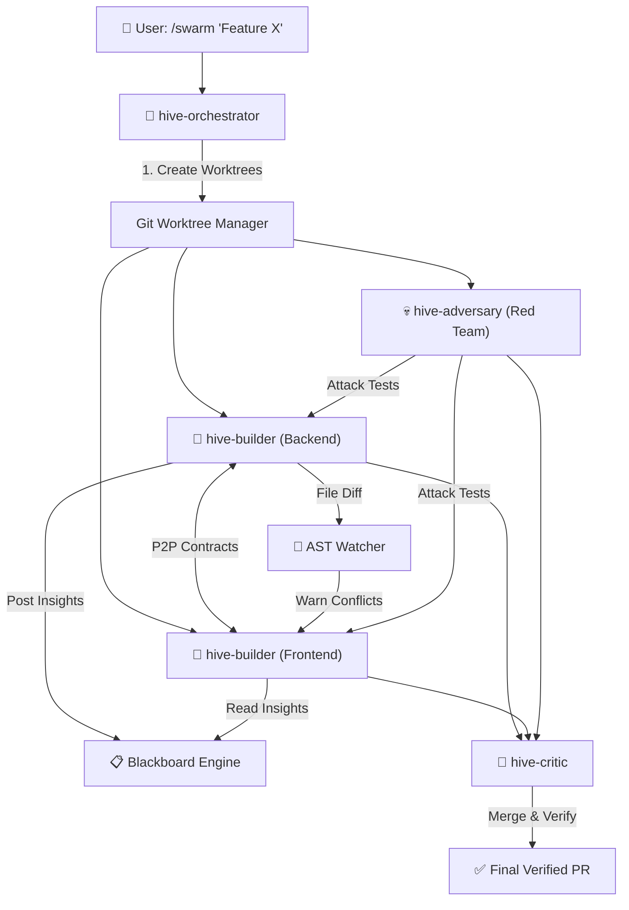

# 🐝 HiveMesh — Multi-Agent Swarm Engine for Antigravity

[](https://opensource.org/licenses/MIT)
[](https://github.com/ghazy2001/hivemesh)

**HiveMesh** is an all-in-one multi-agent orchestration plugin for **Google Antigravity** and **Claude Code**. It transforms a single prompt into an autonomous swarm of specialized agents working in parallel Git worktrees with:

1. 📋 **The Blackboard**: In-memory shared knowledge store (reduces redundant tokens by ~70%).
2. 🔬 **AST-Conflict Watcher**: Real-time detection of function and interface signature changes across branches to prevent semantic build breaks.
3. 🤝 **P2P Contract Negotiation**: Inter-agent interface handshakes before coding begins.
4. 💀 **Adversarial Red Team**: Automated attacker agent fuzzing and probing code for bugs, race conditions, and vulnerabilities.
5. 📊 **Mission Control Dashboard**: Live status tracking directly in the conversation.

---

## 🏗️ Architecture



---

## 🛠️ MCP Tools

| Tool | Description |
|:-----|:------------|
| `hivemesh_create_swarm` | Creates isolated Git worktrees and branches for parallel agents. |
| `hivemesh_swarm_status` | Returns the real-time status of all agents and active worktrees. |
| `hivemesh_destroy_swarm` | Cleans up worktrees and branches when work is done. |
| `hivemesh_blackboard_post` | Publishes architectural discoveries, conventions, or findings. |
| `hivemesh_blackboard_query` | Queries shared knowledge by topic or key. |
| `hivemesh_blackboard_list_topics` | Lists all knowledge categories currently on the blackboard. |
| `hivemesh_propose_contract` | Proposes an API/schema contract between two agents. |
| `hivemesh_respond_contract` | Accepts or rejects a proposed interface contract. |
| `hivemesh_check_ast_changes` | Scans for semantic signature changes and cross-branch conflicts. |
| `hivemesh_dashboard` | Generates a live markdown mission control dashboard. |

---

## 👥 Specialized Agent Roles

- **`hive-orchestrator`**: Master coordinator, decomposes prompts, creates swarms, coordinates merges.
- **`hive-builder`**: Feature implementation specialist operating strictly in an isolated worktree.
- **`hive-adversary`**: Red-team security tester that fuzzes inputs, tests race conditions, and writes attack tests.
- **`hive-critic`**: Integration reviewer that verifies AST changes, contracts, builds, and test runs before merge.

---

## 🚀 Quick Start

1. Ensure the plugin is placed in `~/.gemini/config/plugins/hivemesh/`.
2. Build the TypeScript engine:
   ```bash
   cd engine && npm install && npm run build
   ```
3. Restart Antigravity to reload plugin configurations.
4. Launch a swarm from chat:
   ```text
   Use the hivemesh skill to create a swarm of 3 agents for adding webhooks with backend, frontend, and adversarial testing.
   ```

---

## 📄 License
MIT © [Mahmoud Ghazy](https://github.com/ghazy2001)
